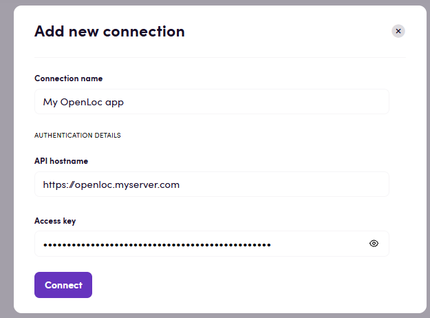

# Blackbird.io OpenLoc

Blackbird is the new automation backbone for the language technology industry. Blackbird provides enterprise-scale automation and orchestration with a simple no-code/low-code platform. Blackbird enables ambitious organizations to identify, vet and automate as many processes as possible. Not just localization workflows, but any business and IT process. This repository represents an application that is deployable on Blackbird and usable inside the workflow editor.

## Introduction

<!-- begin docs -->

[OpenLoc](https://openloc.com/product/) is a translation management system for managing content, translation and review workflows. 

## Before Connecting

1. Make sure you have access to an OpenLoc account and know the HTTPS hostname URL.
2. Obtain an active access key from _AI settings > Access keys_ in OpenLoc.

## Connecting

1. Navigate to apps and search for OpenLoc.
2. Click _Add Connection_.
3. Name your connection for future reference e.g. 'My OpenLoc connection'.
4. Enter **API hostname**: the HTTPS origin serving your OpenLoc API.
5. Enter **Access key**: your active key from _AI settings > Access keys_. 
6. Save the connection and confirm that it appears in your connections.

## Actions

### Projects

- **Search projects** Find all projects matching the selected filters.
- **Get project** Get the details of a selected project.
- **Create project** Create a translation project.

### Jobs

- **Search jobs** Find jobs in a project matching optional filters.
- **Get job** Get a job's details, progress and current workflow step.
- **Update job** Change the user assigned to a job's current workflow step.

### Files

- **Download original file** Download the original document exactly as it was uploaded.
- **Upload file** Upload a document and create its translation jobs, one per target language.
- **Download translated file** Download a translated document in its original format or as bilingual XLIFF 1.2.

### Segments

- **Save draft translation** Save translation text without approving it; the segment returns to needs review.
- **Confirm segment translation** Approve a translation and save it to the project's writable translation memories.
- **Add segment comment** Add a comment to a translation segment.
- **Search job segments** Get source text and translations for all matching segments in a job.

## Events

### Projects

- **On project status changed** Triggers when an existing project's status changes, optionally to a selected status.

## Feedback

Do you want to use this app or do you have feedback on our implementation? Reach out to us using the [established channels](https://www.blackbird.io/) or create an issue.

<!-- end docs -->
